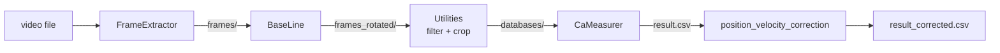

# AutomaticVideoProcessor (AVP)

Automatic processing of high-speed videos of drops sliding on a tilted surface. For every frame AVP finds the drop and measures the **advancing and receding contact angles**, contact-line length, drop centre and velocity.

## Pipeline



[AVP.py](AVP.py) runs these stages on each experiment folder (`process_folder`):

| # | Stage | Call | Output in the experiment folder |
|---|-------|------|----------------------------------|
| 0 | Clean | `cleanUP(folder)` | Deletes `frames/`, `frames_rotated/`, `databases/`, `SR_edge/`, `error_log.txt`, `result.csv`, `result_video.mkv` |
| 1 | Frame extraction | `FrameExtractor.FrameExtractor().Forward(folder)` | `frames/frame_%06d.png` (cropped, grayscale) |
| 2 | Baseline levelling | `BaseLine.BaseLine().Forward(folder)` | `frames_rotated/*.png`, `frames/Rotation.png` |
| 3 | Drop filtering | `Utilities.YoloWalker.run(...)`, `Utilities.singleFolderDropNormalizer(...)` | Deletes frames in `frames_rotated/` with no drop or with the drop at the image edge |
| 4 | Crop | `Utilities.crop_Save(folder)` | `databases/frame_*.png`, `databases/detections.csv` |
| 5 | Contact angles | `CaMeasurer.processes_mp_shared(...).run(folder)` | `SR_edge/frame_*.png`, `result.csv` |
| 6 | Post-processing | `Utilities.position_velocity_correction("result.csv")` | `result_corrected.csv` |
| 7 | Marker | — | `.done` (written if `error_log.txt` is absent in the folder) |

If any stage raises, the exception is written to `log_<timestamp>.log` in the experiment folder. Frames that fail inside `CaMeasurer` are logged to `databases/error_log.txt`.

## Folder layout

Each experiment is a folder that contains **exactly one** video (`.mp4 .mov .avi .mkv .mpeg .mpg .m4v`):

```
<experiment>/
├── <video>.mp4
├── frames/                 # FrameExtractor (+ Rotation.png from BaseLine)
├── frames_rotated/         # BaseLine, then filtered by Utilities
├── databases/              # Cropped, inverted drop images
│   ├── frame_*.png
│   ├── detections.csv      # image, endpoint, beginning
│   └── error_log.txt       # per-frame CaMeasurer failures (if any)
├── SR_edge/                # One diagnostic figure per frame
├── result.csv
├── result_corrected.csv
├── .done
└── log_<timestamp>.log     # Only on failure
```

`result.csv` columns: `file number`, `time (s)`, `x_center (cm)`, `adv (degree)`, `rec (degree)`, `contact_line_length (cm)`, `y_center (cm)`, `middle_angle_degree (degree)`, `velocity (cm/s)`.

## Installation

Requirements:
- Linux with an NVIDIA GPU; YOLO inference is hard-coded to `device="cuda"`.
- `ffmpeg` and `ffprobe` on `PATH`.
- A conda environment (the service uses `torch3.13` from miniforge3; `torch3.11` is also used).

```bash
pip install -r requirements.txt
python pre_requisites.py   # Checks ffmpeg/ffprobe; rebuilds TensorRT .engine files if the TensorRT version changed
```

[ContinuousDropsTOSegmented.py](ContinuousDropsTOSegmented.py) also needs `send2trash`, which is not in `requirements.txt`.

## Usage

```bash
python AVP.py                    # One pass over all pending folders
python AVP.py --daemon           # Keep polling for new folders
python AVP.py --daemon --poll-interval 60 --stability-seconds 60
python AVP.py -C --video-list /path/a /path/b   # Clean these folders first, then process
```

| Flag | Default | Meaning |
|------|---------|---------|
| `-C`, `--clean` | off | Run `cleanStart` (removes outputs, `.done` and `*.log`), then continue processing |
| `--video-list` | — | Folders to clean; without it `-C` cleans `/media/Dont/Teflon-AVP/*/*/*` |
| `--daemon` | off | Poll for new folders instead of a single pass |
| `--poll-interval` | `60` | Seconds between rescans in daemon mode |
| `--stability-seconds` | `60` | A folder must be unchanged this long before it is processed (avoids half-copied folders) |

The source folder is set in `AVP.py` as `VIDEO_SOURCE_GLOB = "/media/roboprocessing/Data/Samba-Share/RobotScientistClips/*"`. A folder is pending when it has no `.done`, no `error_log.txt` and no `*.log`.

To run AVP as a systemd service see [deploy/readme.md](deploy/readme.md).

## Configuration

All modules read [config.yaml](config.yaml) through `BaseUtils.config`.

| Key | Value | Used by |
|-----|-------|---------|
| `Video.cropping_properties.{X,Y,WIDTH,HEIGHT}` | `750, 0, 1000, 188` | FrameExtractor (ffmpeg crop); `WIDTH` also by Utilities |
| `Video.Original_image.{WIDTH,HEIGHT}` | `2048, 192` | Reference only |
| `single_FolderDropNormalizer.Left_boundary_ratio` | `0.90` | Utilities |
| `single_FolderDropNormalizer.Right_boundary_ratio` | `0.06` | Utilities |
| `image_extension` | `"*.png"` | All |
| `frame_rate` | `30` | Not used (FPS is read with ffprobe) |
| `frame_folder` / `rotated_frames_folder` / `databases_folder` | `frames` / `frames_rotated` / `databases` | All |
| `yolo_conf` | `0.6` | BaseUtils (YOLO) |
| `yolo_name`, `extension_yolo` | `Gray-320-s`, `pt` | BaseUtils (weights file) |
| `Experiment_Parameters.fps_experiment` | `4000` | CaMeasurer (time and velocity) |
| `Experiment_Parameters.cm_on_pixel_ratio` | `0.0039062` | CaMeasurer |
| `Experiment_Parameters.num_px_ratio` | `1` | CaMeasurer (pixel counts for fitting) |
| `PreProcessing.buttom_Line_height` | `5` | CaMeasurer (rows cut from the bottom of each crop) |
| `Super_Resolution.upscale_factor` | `3` | CaMeasurer |
| `Super_Resolution.model_path` | `CaMeasurer/models/converted_model.pt` | CaMeasurer |
| `Processing_Parameters.edge_Detection_threshold` | `30` | CaMeasurer (edge threshold) |

## Modules

| Package | Purpose |
|---------|---------|
| [FrameExtractor](FrameExtractor/README.md) | Extracts, crops and checks frames with ffmpeg |
| [BaseLine](BaseLine/README.md) | Levels the surface and blacks out everything below it |
| [BaseUtils](BaseUtils/README.md) | Config, frame listing, drop detectors (YOLO / SUM / difference), logging |
| [Utilities](Utilities/README.md) | Drop filtering, cropping, result post-processing, video tools |
| [CaMeasurer](CaMeasurer/README.md) | Super-resolution, edge extraction and contact-angle measurement |
| [deploy](deploy/readme.md) | systemd service |

Design rules:
- Each module works on a single image or a single folder.
- Assumptions and exception handling live in the package `__init__.py`.

## Other scripts

| Script | Purpose |
|--------|---------|
| [AVP copy.py](AVP%20copy.py) | Single pass of the same pipeline over `/run/media/roboprocessing/Data/Samba-Share/Test/*`; no daemon mode |
| [AVPV2.py](AVPV2.py) | Older pipeline over `D:\HSC_OPCUA_output`: YOLO forward/backward filtering, separate super-resolution to `databases_SR/`, `CaMeasurer.V1__init__.processes`, and `result_plots.png` |
| [AVP_Pass2.py](AVP_Pass2.py) | Re-measures frames missing from `result.csv` in `/media/d25u2/Dont/Viscosity/*/*/*` |
| [ContinuousDropsTOSegmented.py](ContinuousDropsTOSegmented.py) | Splits a video with several drops into one video per drop (`/media/d25u2/Dont/Viscosity/SDS/*/*/*.mp4`) |
| [Multi_Video.py](Multi_Video.py) | Plays several videos in a grid (`MultiVideo(video_paths, VideoGrid=(3, 5))`) |
| [cleanUp.py](cleanUp.py) | `create_video_from_images(...)`: builds an MP4 from frames with ffmpeg |
| [pre_requisites.py](pre_requisites.py) | ffmpeg/ffprobe check and TensorRT engine rebuild |
| [INFO.py](INFO.py) | Counts lines of Python code in the project |

> [!IMPORTANT]
> Change scaleDown value for drop detection from 5 to 1.

## License

GNU General Public License v3.0 — see [LICENSE](LICENSE). Authors: Yassin Riyazi, Sajjad Shumaly (Max Planck Institute for Polymer Research).