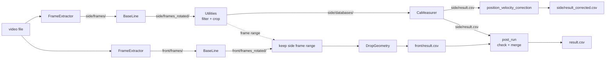

# AutomaticVideoProcessor (AVP)

Automatic processing of high-speed videos of drops sliding on a tilted surface. Each video shows the drop from the side and from the front. From the **side view** AVP measures the **advancing and receding contact angles**, contact-line length, drop centre and velocity. From the **front view** it measures the **drop height, width, base width and centroid**.

## Pipeline



[main.py](main.py) runs the side view and then the front view of each experiment folder (`process_folder`). A view runs only if it is pending, and the front view also waits until the side view has written `side/result.csv`.

Three folder trees share the same relative structure:

| Tree | Path (config.yaml) | Contents |
|------|--------------------|----------|
| Input | `Root_Address/Video_Addresses` (`.../Samba-Share/RobotScientistClips`) | Uploaded videos. Watched; never modified by AVP |
| Work | `Temporary_Processing.address` (`/run/media/roboprocessing/Data/tmp_processing`) | Everything below: frames, detail images, CSVs, logs. Outside the Samba share, so the thousands of images are not synced. The video is hard-linked in while it is processed |
| Mirror | `Root_Address/Output_Address` (`.../Samba-Share/RoboprocessingOutput`) | Only the `*.csv`, `*.log`, `*.txt` (error logs) and `.done` files of the work folder, copied after each view and after the merge |

For example `RobotScientistClips/2026-10-20_15-20-34-103845/tilt-25-rep-001/` is processed in `tmp_processing/2026-10-20_15-20-34-103845/tilt-25-rep-001/` and mirrored to `RoboprocessingOutput/2026-10-20_15-20-34-103845/tilt-25-rep-001/`. The mirror is the record of what has been processed, so trimming the work folder never causes reprocessing. If a folder still needs its front view or merge but its side work outputs were trimmed, the folder is processed again from the start.

The work folder is kept below `Temporary_Processing.max_files` (3,000,000) files and `max_size_gb` (500 GB). After each video, the least recently processed experiment work folders are deleted until both limits are met. Whole experiment folders are deleted, never single files, and never the folder being processed. Usage per folder is recorded in `tmp_processing/.avp_usage.json`, so the work folder is fully counted only once, on first start.

| # | View | Stage | Call | Output |
|---|------|-------|------|--------|
| 0 | both | Clean | `cleanUP(folder, view)` | Deletes partial outputs of an interrupted run in `<view>/` |
| 1 | side | Frame extraction | `FrameExtractor.FrameExtractor(SECONDARY_ADDRESS="side").Forward(folder)` | `side/frames/frame_%06d.png` (cropped, grayscale) |
| 2 | side | Baseline levelling | `BaseLine.BaseLine(SECONDARY_ADDRESS="side").Forward(folder)` | `side/frames_rotated/*.png`, `side/frames/Rotation.png` |
| 3 | side | Drop filtering | `Utilities.YoloWalker.run(...)`, `Utilities.singleFolderDropNormalizer(...)` | Deletes frames in `side/frames_rotated/` with no drop or with the drop at the image edge |
| 4 | side | Crop | `Utilities.crop_Save(side)` | `side/databases/frame_*.png`, `side/databases/detections.csv` |
| 5 | side | Contact angles | `CaMeasurer.processes_mp_shared(...).run(side)` | `side/SR_edge/frame_*.png`, `side/result.csv` |
| 6 | side | Post-processing | `Utilities.position_velocity_correction("side/result.csv")` | `side/result_corrected.csv` |
| 7 | front | Frame extraction and levelling | as 1–2 with `SECONDARY_ADDRESS="front"` | `front/frames_rotated/*.png` |
| 8 | front | Frame range | — | Deletes front frames outside the first–last frame of `side/frames_rotated/` |
| 9 | front | Drop geometry | `DropGeometry.process_folder(front)` | `front/result.csv`, `front/SR_edge/frame_*.png` |
| 10 | both | Marker | — | `<view>/.done` (written if `<view>/error_log.txt` is absent), then the raw `frame_*.png` in `<view>/frames/` are deleted |
| 11 | both | Merge | `post_run(folder)` | `result.csv` (side and front rows matched on `file number`), `post_run_error.txt` if a check fails |

If any stage raises, the exception is written to `<view>/log_<timestamp>.log` and that view is not retried. Frames that fail inside `CaMeasurer` are logged to `side/databases/error_log.txt`; frames that fail inside `DropGeometry` to `front/error_log.txt`.

## Folder layout

Each experiment is a folder in the input tree that contains **exactly one** video (`.mp4 .mov .avi .mkv .mpeg .mpg .m4v`). Its work folder in `tmp_processing/<relative path>/` holds (files marked * are also mirrored to `RoboprocessingOutput/<relative path>/`):

```
<experiment>/
├── <video>.mp4                 # Hard link, only while the folder is processed
├── .done                       # * post_run finished
├── result.csv                  # * post_run: side/result.csv + front/result.csv, one row per frame
├── post_run_error.txt          # * Only if a post_run check failed
├── side/
│   ├── frames/Rotation.png     # BaseLine diagnostic (raw frames are deleted after success)
│   ├── frames_rotated/         # BaseLine, then filtered by Utilities
│   ├── databases/              # Cropped, inverted drop images
│   │   ├── frame_*.png
│   │   ├── detections.csv      # * image, endpoint, beginning
│   │   └── error_log.txt       # * per-frame CaMeasurer failures (if any)
│   ├── SR_edge/                # One diagnostic figure per frame
│   ├── result.csv              # *
│   ├── result_corrected.csv    # *
│   ├── .done                   # *
│   └── log_<timestamp>.log     # * Only on failure
└── front/
    ├── frames/Rotation.png
    ├── frames_rotated/         # Same frame names as side/frames_rotated
    ├── SR_edge/                # One plot of the boundary and features per frame
    ├── result.csv              # *
    ├── .done                   # *
    ├── error_log.txt           # * per-frame DropGeometry failures (if any)
    └── log_<timestamp>.log     # * Only on failure
```

`side/result.csv` columns: `file number`, `time (s)`, `x_center (cm)`, `adv (degree)`, `rec (degree)`, `contact_line_length (cm)`, `y_center (cm)`, `middle_angle_degree (degree)`, `velocity (cm/s)`. For `front/result.csv` see [DropGeometry](DropGeometry/README.md); its `file number` matches the side view.

`result.csv` is written by `post_run` after both views finish, whether or not they succeeded, as long as both have a `result.csv`. It has one row per frame, matched on `file number`. Every other column keeps its name with a `side ` or `front ` prefix, for example `side adv (degree)` and `front height (cm)`. It merges the raw `side/result.csv`, not `result_corrected.csv`. `post_run` checks that:
- both views have `.done` and no per-frame error log (`side/databases/error_log.txt`, `side/error_log.txt`, `front/error_log.txt`);
- `side/frames_rotated` and `front/frames_rotated` hold the same frames;
- every kept frame except the last has exactly one row with no empty values in both CSVs, and no CSV has rows for other frames. The side view never measures the last frame because its velocity is a forward difference;
- `side time (s)` equals `(frame - first frame) / fps_experiment`. CaMeasurer numbers time by row, so a skipped frame shifts the time and velocity of every frame after it.

If a check fails, the problems are written to `post_run_error.txt` and `result.csv` still holds the frames both views measured. A folder whose views are finished but that has neither `result.csv` nor `post_run_error.txt` is merged on the next run or daemon scan. `cleanUP`/`-C` deletes both files together with the view outputs.

## Installation

Requirements:
- Linux with an NVIDIA GPU; YOLO inference is hard-coded to `device="cuda"`.
- `ffmpeg` and `ffprobe` on `PATH`.
- A conda environment (the service uses `torch3.11` from miniforge3).

```bash
pip install -r requirements.txt
python pre_requisites.py   # Checks ffmpeg/ffprobe; rebuilds TensorRT .engine files if the TensorRT version changed
```

[ContinuousDropsTOSegmented.py](ContinuousDropsTOSegmented.py) also needs `send2trash`, which is not in `requirements.txt`.

## Usage

```bash
python main.py                    # One pass over all folders with a pending view
python main.py --daemon           # Watch Root_Address and process each upload once its video stops being written
python main.py --daemon --poll-interval 10 --stability-seconds 60
python main.py -C --video-list /path/a /path/b   # Delete both views of these folders first, then process
python main.py -C front                          # Recompute the front view of every folder
```

| Flag | Default | Meaning |
|------|---------|---------|
| `-C`, `--clean [VIEW ...]` | off | Delete the outputs, `.done` and `*.log` of these views (`side`, `front`; default both), then continue processing |
| `--video-list` | — | Input video folders to clean (in the work folder and the mirror); without it `-C` cleans every video folder |
| `--daemon` | off | Watch `Root_Address/Video_Addresses` instead of a single pass (see below) |
| `--poll-interval` | `Daemon.poll_interval` (10) | Seconds between rescans in daemon mode |
| `--stability-seconds` | `Daemon.stability_seconds` (60) | A video must go unwritten this long before its folder is queued (avoids half-uploaded videos) |

Source folders are discovered recursively beneath `Root_Address/Video_Addresses` from [config.yaml](config.yaml), at any depth. Discovery stops descending into a folder once it contains a matching video, avoiding its processing outputs. The video stem must equal its parent folder name or start with that name followed by `_`, for example `tilt-25-rep-002/tilt-25-rep-002_4000fps.mp4`. Exactly one matching video is required for processing; unrelated video names and hidden temporary uploads are ignored.

A view is pending when `<view>/` in the mirror has no `.done`, no `error_log.txt` and no `*.log`.

In daemon mode a watcher thread repeats this recursive discovery every `poll_interval` seconds, so newly created date folders and experiment folders are found without restarting. A folder with a pending view is queued once all its matching videos are non-empty and none has been written (mtime and ctime) for `stability_seconds`. A single worker then processes the queue in upload order. Before processing, the worker checks the video again; if it was rewritten, the folder is dropped from the queue and queued again once it stops changing. A processed folder is queued again only if its video changes.

[main_side.py](main_side.py) and [main_front.py](main_front.py) run a single view.

To run AVP as a systemd service see [deploy/readme.md](deploy/readme.md).

## Configuration

All modules read [config.yaml](config.yaml) through `BaseUtils.config`.

| Key | Value | Used by |
|-----|-------|---------|
| `Root_Address` | `/run/media/roboprocessing/Data/Samba-Share` | main.py (the Samba share) |
| `Video_Addresses` | `RobotScientistClips` | main.py: input tree under `Root_Address`, watched for videos |
| `Output_Address` | `RoboprocessingOutput` | main.py: mirror under `Root_Address` (CSVs, logs, `.done`) |
| `Temporary_Processing.address` | `/run/media/roboprocessing/Data/tmp_processing` | main.py: work tree (frames and images), outside the share |
| `Temporary_Processing.max_files` / `max_size_gb` | `3000000` / `500` | main.py: limits of the work tree; oldest experiment folders are deleted when exceeded |
| `Daemon.stability_seconds` | `60` | main.py `--daemon`: seconds a video must go unwritten before its folder is queued |
| `Daemon.poll_interval` | `10` | main.py `--daemon`: seconds between scans of `Root_Address/Video_Addresses` |
| `Video.cropping_properties_side.{X,Y,WIDTH,HEIGHT}` | `750, 0, 1000, 188` | FrameExtractor (side ffmpeg crop); `WIDTH` also by Utilities |
| `Video.cropping_properties_front.{X,WIDTH}` | `283, 240` | FrameExtractor (front ffmpeg crop; `Y` and `HEIGHT` from the side) |
| `Video.Original_image.{WIDTH,HEIGHT}` | `2048, 192` | Reference only |
| `single_FolderDropNormalizer.Left_boundary_ratio` | `0.90` | Utilities |
| `single_FolderDropNormalizer.Right_boundary_ratio` | `0.06` | Utilities |
| `image_extension` | `"*.png"` | All |
| `frame_rate` | `30` | Not used (FPS is read with ffprobe) |
| `frame_folder` / `rotated_frames_folder` / `databases_folder` | `frames` / `frames_rotated` / `databases` | All |
| `yolo_conf` | `0.6` | BaseUtils (YOLO) |
| `yolo_name`, `extension_yolo` | `Gray-320-s`, `pt` | BaseUtils (weights file) |
| `Experiment_Parameters.fps_experiment` | `4000` | CaMeasurer (time and velocity) |
| `Experiment_Parameters.cm_on_pixel_ratio` | `0.0039062` | CaMeasurer |
| `Experiment_Parameters.front_cm_on_pixel_ratio` | `0.004542` | DropGeometry (constant front scale) |
| `Experiment_Parameters.num_px_ratio` | `1` | CaMeasurer (pixel counts for fitting) |
| `PreProcessing.buttom_Line_height` | `5` | CaMeasurer (rows cut from the bottom of each crop) |
| `Super_Resolution.upscale_factor` | `3` | CaMeasurer |
| `Super_Resolution.model_path` | `CaMeasurer/models/converted_model.pt` | CaMeasurer |
| `Processing_Parameters.edge_Detection_threshold` | `30` | CaMeasurer (edge threshold) |

## Modules

| Package | Purpose |
|---------|---------|
| [FrameExtractor](FrameExtractor/README.md) | Extracts, crops and checks frames with ffmpeg |
| [BaseLine](BaseLine/README.md) | Levels the surface and blacks out everything below it |
| [BaseUtils](BaseUtils/README.md) | Config, frame listing, drop detectors (YOLO / SUM / difference), logging |
| [Utilities](Utilities/README.md) | Drop filtering, cropping, result post-processing, video tools |
| [CaMeasurer](CaMeasurer/README.md) | Super-resolution, edge extraction and contact-angle measurement |
| [DropGeometry](DropGeometry/README.md) | Drop height, width, base width and centroid (front view) |
| [deploy](deploy/readme.md) | systemd service |

Design rules:
- Each module works on a single image or a single folder.
- Assumptions and exception handling live in the package `__init__.py`.

## Other scripts

| Script | Purpose |
|--------|---------|
| [.BK/AVP copy.py](.BK/AVP%20copy.py) | Single pass of the old single-view pipeline over `/run/media/roboprocessing/Data/Samba-Share/Test/*`; no daemon mode |
| [.BK/AVPV2.py](.BK/AVPV2.py) | Older pipeline over `D:\HSC_OPCUA_output`: YOLO forward/backward filtering, separate super-resolution to `databases_SR/`, `CaMeasurer.V1__init__.processes`, and `result_plots.png` |
| [.BK/AVP_Pass2.py](.BK/AVP_Pass2.py) | Re-measures frames missing from `result.csv` in `/media/d25u2/Dont/Viscosity/*/*/*` |
| [ContinuousDropsTOSegmented.py](ContinuousDropsTOSegmented.py) | Splits a video with several drops into one video per drop (`/media/d25u2/Dont/Viscosity/SDS/*/*/*.mp4`) |
| [Multi_Video.py](Multi_Video.py) | Plays several videos in a grid (`MultiVideo(video_paths, VideoGrid=(3, 5))`) |
| [cleanUp.py](cleanUp.py) | `create_video_from_images(...)`: builds an MP4 from frames with ffmpeg |
| [pre_requisites.py](pre_requisites.py) | ffmpeg/ffprobe check and TensorRT engine rebuild |
| [INFO.py](INFO.py) | Counts lines of Python code in the project |

> [!IMPORTANT]
> Change scaleDown value for drop detection from 5 to 1.

## License

GNU General Public License v3.0 — see [LICENSE](LICENSE). Authors: Yassin Riyazi, Sajjad Shumaly (Max Planck Institute for Polymer Research).